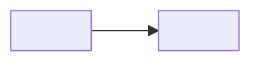

# <Project> — Design

> The authoritative design for <Project>. If anything elsewhere disagrees with this document, this document wins until it is changed through a recorded decision.
>
> **Status:** <Draft | Locked YYYY-MM-DD> · **Decision log:** [kickoff/decision-log.md](kickoff/decision-log.md) · **Research:** [kickoff/research.md](kickoff/research.md) · **ADRs:** [decisions/](decisions/)
>
> **Notation:** `[D-NNN]` is a decision · *verified (source, date)* · *assumed*

## 1. Summary

<What the software is, who uses it and what it must do, in one paragraph.>

## 2. Purpose & scope

- **Problem:** <…> [D-…]
- **Users and roles:** <…>
- **Principles:**
  1. <principle: one line on how it settles disputes>
- **Non-goals:** <…>
- **Done for v1 means:** <testable statement>

| MVP | Later | Out of scope |
|---|---|---|
| <feature (ID)> | <feature> | <thing> |

## 3. Features & behaviour

<Key scenarios first. Then one subsection per major feature area, with inputs, rules, states and edge cases.>

### 3.1 <Feature area>

## 4. Architecture

<Overall shape, component responsibilities and boundaries, where the source of truth lives, how components communicate.>

## 5. <One section per area of the question map>

<Each area that produced decisions gets its own section here, in a sensible reading order: for example stack, data, interfaces, security, testing, deployment, workflow. Write the decisions as statements with their IDs.>

## 6. Constraints & assumptions

## 7. Risks

<Top risks in one line each; the full list is in [development/risks.md](development/risks.md).>

## 8. Calls made by Claude

These decisions were delegated to Claude. Review them and change any you disagree with.

- <decision> [D-…]

## 9. Open & deferred

<One line each; the detail is in [development/open-questions.md](development/open-questions.md).>
